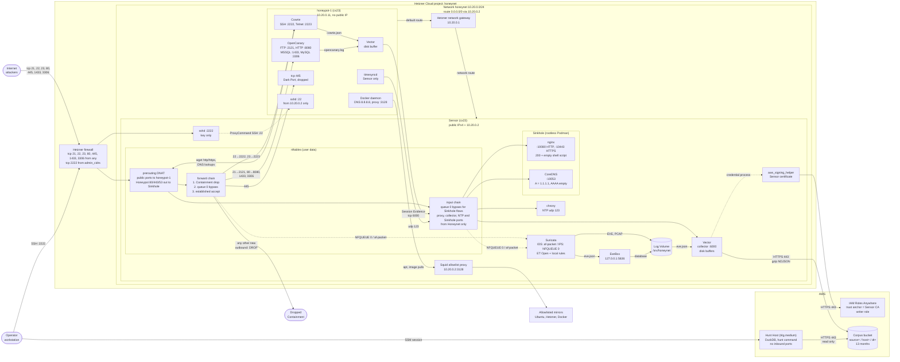

# Honeynet

The Honeynet attracts real attacks so that Suricata can inspect hostile traffic. It is hostile by design. It shares no network, Hetzner project, token or SSH key with other environments. For the terms, see [CONTEXT.md](./CONTEXT.md).

## Architecture



## Hosts

| Host | Address | Runs |
|---|---|---|
| Sensor | Public IPv4, `10.20.0.2` | nftables, Suricata, EveBox, Squid, Sinkhole (nginx, CoreDNS), Vector, `aws_signing_helper`, chrony |
| `honeypot-1` | `10.20.0.11`, no public IP | Cowrie and OpenCanary in Docker, Vector, timesyncd |
| Hunt Host | AWS VPC public subnet, no inbound ports | DuckDB, the `hunt` command |

The Log Volume is attached to the Sensor at `/srv/honeynet`. It holds `/var/log/suricata` and `/var/lib/evebox`, and it stays when Terraform replaces the Sensor.

Every packet between the internet and a Honeypot goes through the Sensor. The Honeypot default route goes to the Hetzner network gateway. The network route sends it to the Sensor.

## Traffic

| Flow | Path | Result |
|---|---|---|
| Attack on a honeypot port | Sensor DNAT, then forward chain | Cowrie or OpenCanary answers. Port 445 times out. |
| New Honeypot connection to the internet | Forward chain, rule 1 | Dropped (Containment). |
| Honeypot HTTP, HTTPS or DNS to the internet | Sensor DNAT to the Sinkhole | The Sinkhole answers. Nothing leaves the Honeynet. |
| Honeypot apt and image pulls | Squid on `10.20.0.2:3128` | Allowlisted domains only. |
| Operator SSH | Sensor `:2222`, then ProxyCommand to Honeypot `:22` | Key only, from `admin_cidrs`. |
| Session Evidence | Honeypot Vector to Sensor Vector on `10.20.0.2:6000` | The Sensor forwards records from known sources and hosts only. |
| Telemetry to the Corpus | Sensor Vector to S3 over HTTPS, with Roles Anywhere credentials | Gzip objects under `source=/host=/dt=`, kept 13 months. |
| Honeypot time | timesyncd to chrony on Sensor `udp 123` | The Honeypot ignores time servers from DHCP. |
| Hunt | Operator SSM session to the Hunt Host. DuckDB reads the Corpus over HTTPS. | Read only. The Hunt Host accepts no inbound connections. |

Suricata sees all forwarded and Sinkhole flows. In IPS mode, `bypass` makes the Sensor fail open when Suricata does not read the queue. Containment does not depend on Suricata.

## Ports

| Public port | Honeypot port | Service |
|---|---|---|
| 22 | 2222 | Cowrie SSH |
| 23 | 2223 | Cowrie Telnet |
| 21 | 2121 | OpenCanary FTP |
| 80 | 8080 | OpenCanary HTTP |
| 1433 | 1433 | OpenCanary MSSQL |
| 3306 | 3306 | OpenCanary MySQL |
| 445 | 445 | Dark Port, no service |

## Terraform roots

| Root | Stack component | Owns |
|---|---|---|
| `bootstrap/` | `hetzner/honeynet/bootstrap` | The Hetzner SSH key and the Sensor public IPv4. It keeps its state locally. |
| `live/aws/honeynet/corpus/` | `aws/honeynet/corpus` | The Corpus bucket, the Sensor writer role and the Roles Anywhere trust anchor |
| `network/` | `hetzner/honeynet/network` | The network `10.20.0.0/24` and its route to the Sensor |
| `sensor/` | `hetzner/honeynet/sensor` | The Sensor, its firewall and the Log Volume |
| `honeypots/` | `hetzner/honeynet/honeypots` | `honeypot-1` |
| `live/aws/honeynet/hunt/` | `aws/honeynet/hunt` | The Hunt Host, its VPC and its scratch bucket |

## Workflows

The workflows are in `stacks/workflows/honeynet.yaml`. All workflows need `AWS_PROFILE`. All workflows except `apply-hunt`, `configure-hunt` and `verify-hunt` also need `HONEYNET_HCLOUD_TOKEN`.

| Workflow | Does |
|---|---|
| `apply` | Applies `bootstrap`, generates the Sensor CA, then applies `corpus`, `network`, `sensor`, `honeypots` and `hunt`, in that order. |
| `destroy` | Destroys `hunt`, `honeypots`, `sensor`, `network` and `bootstrap`, in that order, then deletes `pki/`. It never destroys `corpus`. |
| `configure` | Writes the inventory from the Terraform outputs, then runs `site.yml`. |
| `verify` | Runs `verify.yml` against the Sensor and the Honeypots. |
| `apply-hunt` | Applies `hunt` alone. |
| `configure-hunt` | Installs DuckDB on the Hunt Host and creates the normalising views. |
| `verify-hunt` | Runs the Hunt `verify.yml`. Run `verify` first. |
| `destroy-corpus` | Destroys `corpus` alone. See [Full teardown](#full-teardown). |

## Provisioning

Do the [prerequisites](../../../README.md#prerequisites) first. The Honeynet keeps its state in the bucket that `live/hetzner/ovpn/bootstrap` creates.

1. Create a key pair for the Honeynet only, at `~/.ssh/honeynet`. Do not use a key that is trusted elsewhere.
2. Set `admin_cidrs` in `sensor/terraform.tfvars`. This file is not in Git.
3. Provision and configure:

   ```sh
   atmos workflow apply -f honeynet      # bootstrap, Sensor CA, corpus, network, sensor, honeypots, hunt
   atmos workflow configure -f honeynet  # writes the inventory, runs site.yml, issues the Sensor certificate
   atmos workflow verify -f honeynet     # runs verify.yml
   ```

   `bootstrap` creates the Hetzner SSH key and the Sensor public IPv4, and keeps its state locally. The `corpus` root reads this address by name, so `bootstrap` comes before `corpus`.

4. Configure and verify the Hunt Host:

   ```sh
   atmos workflow configure-hunt -f honeynet  # installs DuckDB and creates the normalising views
   atmos workflow verify-hunt -f honeynet     # runs the Hunt verify.yml
   ```

   Run `verify` before `verify-hunt`. `verify-hunt` reads the Session Evidence probe that `verify` sends, and it finds only a probe from the last 7 days.

The order is fixed:

1. The `apply` workflow generates the Sensor CA in `pki/` on the workstation after `bootstrap` and before `corpus`, if `pki/ca.crt` does not exist. The CA private key does not leave the workstation.
2. The `corpus` apply registers the CA certificate as the Roles Anywhere trust anchor.
3. The `configure` workflow generates the Sensor private key on the Sensor and issues a new Sensor certificate from the CA. Each run issues a new certificate. Nothing on the Sensor renews it.

To plan one root, run Atmos directly. The `corpus` root reads `pki/ca.crt` and the Sensor primary IP at plan, so `pki/` and `bootstrap` must exist:

```sh
atmos terraform plan aws/honeynet/corpus -s honeynet
```

### Teardown

The `destroy` workflow removes `hunt`, `honeypots`, `sensor`, `network` and `bootstrap` in that order, then deletes `pki/`. It never destroys `corpus`, so the Corpus keeps 13 months of telemetry. The next `apply` generates a new CA, and Hetzner gives the Sensor a new address. `corpus` puts that address in the writer role permission policy. See [ADR-0022](../../../docs/adr/0022-the-corpus-outlives-the-honeynet.md) and [ADR-0023](../../../docs/adr/0023-the-bootstrap-root-is-disposable-and-the-sensor-address-is-read-at-apply.md).

The workflow does not turn off delete protection. Do these steps by hand first:

1. Decide what to do with the Log Volume. To keep it, remove it from the `sensor` state. To delete it, set `delete_protection = false` and apply. See [Rules](#rules).
2. Set `delete_protection = false` on `hcloud_primary_ip.sensor` in `bootstrap/main.tf`, then apply `bootstrap`:

   ```sh
   atmos terraform apply hetzner/honeynet/bootstrap -s honeynet
   ```

3. Run the Teardown:

   ```sh
   atmos workflow destroy -f honeynet
   ```

4. Set `delete_protection` back to `true` before the next `apply`.

### Full teardown

A full teardown deletes the Corpus and all retained telemetry. This is not the normal procedure. [ADR-0022](../../../docs/adr/0022-the-corpus-outlives-the-honeynet.md) keeps `corpus` across a Teardown.

`destroy-corpus` is the only workflow that destroys `corpus`. The `corpus` root reads `pki/ca.crt` and the Sensor primary IP, so run it while `pki/` and `bootstrap` still exist. Run each step in this order:

1. Empty the Corpus bucket by hand, including all object versions and delete markers. The bucket is versioned. `destroy-corpus` does not empty it, and it stops with an error while the bucket holds objects.
2. `atmos workflow destroy-corpus -f honeynet`
3. Do the [Teardown](#teardown). This also deletes the Hetzner SSH key.

To move an address that an older revision created in the `sensor` root, follow [the address move runbook](../../../docs/runbooks/honeynet-sensor-address-move.md).

## Operation

- **EveBox.** Open an SSH local forward, then go to `http://localhost:5636`:

  ```sh
  ssh -i ~/.ssh/honeynet -p 2222 -L 5636:127.0.0.1:5636 admin@<sensor_public_ipv4>
  ```

- **IDS or IPS.** Set `suricata_mode` in `ansible/playbooks/group_vars/all.yml`, then run `atmos workflow configure -f honeynet`. nftables does not change.
- **Rule updates.** A systemd timer runs `suricata-update` daily for ET Open.
- **Hunt.** The Hunt Host is disposable. To start a hunt on its own, run `atmos workflow apply-hunt -f honeynet`, then `atmos workflow configure-hunt -f honeynet`. To stop it, run `atmos terraform destroy aws/honeynet/hunt -s honeynet`. The Corpus does not change.

## Rules

- User data owns sysctl and nftables on all hosts. Ansible only checks them.
- A change to the honeypot ports, the DNAT or the nftables rules replaces the Sensor. Run `atmos workflow configure -f honeynet` again after the replacement.
- To add a honeypot port, add it to `honeypot_tcp_ports` in the Sensor root. If the port is below 1024, also map it in `honeypot_port_redirects` in `stacks/_honeynet-defaults.yaml`.
- Do not open Containment. Send new outbound protocols to the Sinkhole.
- The Honeynet collects no malware samples.
- To revoke the Sensor credential, set `sensor_writer_profile_enabled = false` in the `corpus` root and run `atmos terraform apply aws/honeynet/corpus -s honeynet`. There is no CRL.
- The Log Volume has delete protection. To destroy the Sensor and keep the logs, run `atmos terraform state rm hetzner/honeynet/sensor -s honeynet module.sensor_log_volume.hcloud_volume.this` before the `destroy` workflow. Before the next `apply`, import it again with `atmos terraform import hetzner/honeynet/sensor -s honeynet module.sensor_log_volume.hcloud_volume.this <volume_id>`.
- To delete the Log Volume, set `delete_protection = false` on the `sensor_log_volume` module, apply `sensor`, then run the `destroy` workflow.
- Every banner and identity comes from `honeypot_persona` in `ansible/playbooks/group_vars/all.yml`. Do not set a banner in a role.

## Decisions

- [ADR-0013](../../../docs/adr/0013-suricata-runs-on-an-inline-sensor-that-enforces-containment.md): inline Sensor and Containment
- [ADR-0014](../../../docs/adr/0014-a-static-queue-bypass-rule-keeps-the-sensor-network-in-user-data.md): static `queue bypass` rule
- [ADR-0015](../../../docs/adr/0015-opencanary-replaces-dionaea-and-port-445-becomes-a-dark-port.md): OpenCanary and the Dark Port
- [ADR-0016](../../../docs/adr/0016-the-sinkhole-runs-in-rootless-podman-on-the-sensor.md): the Sinkhole
- [ADR-0017](../../../docs/adr/0017-the-sensor-logs-live-on-a-volume-that-outlives-the-sensor.md): the Log Volume
- [ADR-0017](../../../docs/adr/0017-every-honeypot-service-claims-one-ubuntu-persona.md): the Persona
- [ADR-0019](../../../docs/adr/0019-the-sensor-holds-no-long-lived-aws-credential.md): the Sensor credential
